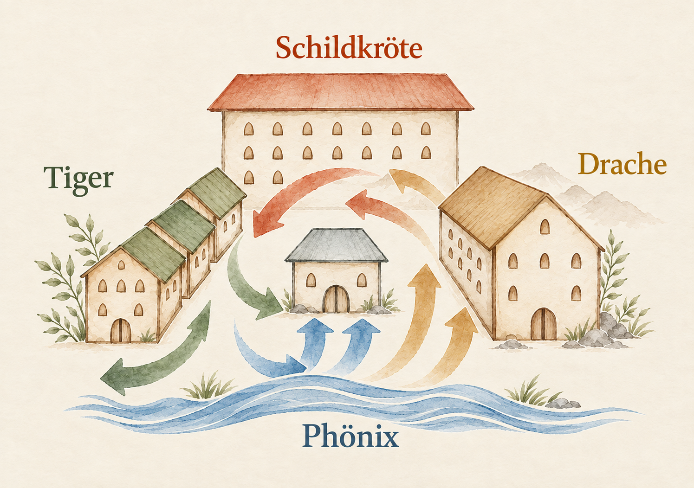
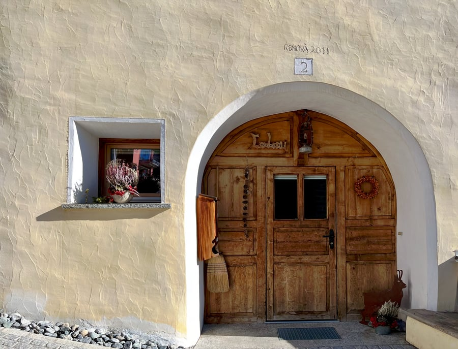

Um eine umfassende Sichtweise über Feng Shui zu bekommen, ist es hilfreich, den historischen Hintergrund genauer zu beleuchten. Tun wir dies, erkennen wir, dass Feng Shui gerade in unserer modernen Welt, wo vieles «ver-rückt» scheint, den Menschen einen bedeutsamen Nutzen bringen kann. Feng Shui war lange Zeit ein Geheimwissen, das im Gebiet des heutigen Chinas schon mindestens 2700 Jahre vor der ersten Kaiserdynastie von Stammesfürsten eingesetzt wurde, um energetisch günstige Plätze für Siedlungsorte zu erspüren und günstige Zeitpunkte für Eroberungen festzulegen.

## Feng Shui – lange ein Privileg der Oberschicht

Während der Zeit der Kaiserreiche (ab 246 v.Chr.) wurden grosse Feng Shui-Meister unter Androhung der Todesstrafe dazu verpflichtet, ihr Wissen ausschliesslich dem Kaiser zur Verfügung zu stellen. Die Machthaber wollten verhindern, dass potenzielle Konkurrenten und die «Untertanen» von diesem Wissen profitieren konnten. Bis zum Ende des letzten Kaiserreiches 1911 war es dem Volk offiziell nicht gestattet, sich von Feng Shui-Meistern beraten zu lassen. Unter der Hand war es jedoch gängig, dass reiche Bauern oder Bürger der Oberschicht Meister für ihre Zwecke konsultierten. Der Flucht - aus Furcht vor dem dortigen System - von 50 Millionen Chinesen von 1927-1976, unter denen sich auch viele Feng Shui-Meister befanden, ist es zu verdanken, dass sich das Feng Shui-Wissen in Asien und von dort aus schliesslich auch gegen Westen verbreitete und öffentlich zugänglich geworden ist. Feng Shui ist in seiner Essenz aber nicht chinesisch, sondern ein zeitlos gültiges, überkulturelles Wissen über Geomantie, das auch bei anderen frühen Völkern wie den Ägyptern, Veden, Griechen und Kelten bekannt war. Vereinfacht ausgedrückt geht es hierbei um das Wissen, wie wir Menschen die irdischen und kosmischen Energien zu unserem Wohle nutzen können.

Der Einfluss der kosmischen Energien wird mit Ebbe und Flut schön veranschaulicht: Wenn bei Vollmond und Neumond Sonne, Mond und Erde in einer Linie stehen und sich ihre Anziehungskräfte so addieren, kann die Flut besonders hoch ausfallen und, im Extremfall (z.B. bei der Tagundnachtgleiche im März und September in Kombination mit stürmischem Wetter), ganze Uferstreifen wegspülen. Als Kind durfte ich dieses beeindruckende Phänomen während eines Ferienaufenthaltes im Frühling auf den kanarischen Inseln beobachten: Eines Morgens war der Sandstrand ganz einfach verschwunden. Er war über Nacht komplett weggespült worden!

## Landschaftliche Feng Shui-Elemente bei Weltstädten

Bei der Wahl eines energetisch günstigen Platzes für einen Siedlungsort, der ein «Kraftort» sein und für Schutz, Gedeihen und Wohlstand stehen sollte, spielte die Topographie eine grundlegende Rolle. Im Feng Shui werden die landschaftlichen Merkmale mit den «symbolischen Tieren» beschrieben: Im Rücken einer Ortschaft oder eines Hauses sollte sich ein Berg (=Schildkröte») als energetische Kraftquelle befinden, der Schutz, Stabilität und Sicherheit vermittelt. Rechts (=Tiger) und links (=Drache) sollte der Ort von Hügeln umarmt werden, die, zusammen mit der Schildkröte eine hufeisenförmige «Umarmung» bilden, das System stabilisieren und dafür sorgen, dass sich die Energie anreichern kann. Vor dem «Kraftort» sollte sich eine offene Fläche, ein See oder ein Fluss befinden. Auf dem offenen Platz kann die Energie frei zirkulieren; das Gewässer stoppt die Energie und reflektiert sie zum «Kraftort» zurück. Da es bei dieser energetischen Anordnung um den Schutz eines Ortes geht, wird hier auch von der «Schutzposition» gesprochen.

Viele Weltstädte wie u.a. Hong Kong, Peking, Seoul, aber auch Zürich erfüllen die Kriterien der symbolischen Tiere in geradezu perfekter Weise: In Zürich wird die Schildkröte von Käfer- und Hönggerberg, der Drache vom Zürichberg, und der Tiger von der Albiskette mit dem Üetliberg gebildet.

Die Rollen der symbolischen Tiere können stellvertretend auch von Nachbargebäuden übernommen werden, wenn die landschaftlichen Merkmale fehlen:

<figure class="figure-wide" data-reveal>

</figure>

## Die «Schutzposition»: Wichtig für Ihr Zuhause

<figure class="figure-side" data-reveal>

</figure>

Das Konzept der «Schutzposition» spielt auch in unserem Zuhause, besonders an Orten wo wir uns häufig aufhalten, eine wichtige Rolle: Das Kopfende Ihres Bettes sollte so an einer Wand (=Schildkröte) stehen, die, idealerweise, gemeinsam mit den Wänden rechts und links vom Bett (=Tiger und Drache) ein Hufeisen bilden. Wenn Sie Kinder haben, so mögen Sie sich vielleicht noch daran erinnern, dass diese als Babies nachts im Schlaf oft im Bett nach oben wanderten und morgens mit dem Kopf an der Bettwand aufwachten? Dahinter steckt die intuitive Suche nach Geborgenheit und Begrenzung («Gebärmutter Effekt»).

Auch am Schreibtisch sollten Sie mit dem Rücken zur Wand und einem freien Blick nach vorne und zur Zimmertüre sitzen, damit Sie stets sehen, wer den Raum betritt. In einer der wohl bekanntesten Büroszenerie in «The Devil Wears Prada» wurde diese Anordnung ganz selbstverständlich umgesetzt. Stellen Sie sich vor, welche psychologische Wirkung es hätte, wenn die Runway-Chefin Miranda auf einmal mit dem Rücken zur Türe sässe und nicht mehr jede eintretende Angestellte mit ihrem abwertenden Blick mustern könnte: Ein Teil ihres aufgebauten Machtkonstruktes würde so unmittelbar in sich zusammenbrechen.

Spannenderweise sind auch in der realen Welt in grösseren Firmen Arbeitsplätze mit einem freien Blick zur Türe vornehmlich Führungspositionen vorbehalten. Arbeitsplätze von Angestellten werden häufig eher lieblos, ohne eine bestimmte Ausrichtung, in Grossraumbüros gar oft mit dem Blick auf eine schalldämmende Wand, die das Gefühl von einem «Brett vor dem Kopf» vermittelt, platziert. Die psychologische Wirkung solch einer Arbeitsumgebung können Sie sich einfach vorstellen.

Weiterführende Informationen zur «Schutzposition» finden Sie in der Rubrik «[Was ist Feng Shui?](/feng-shui#formschule)»

Meine Blog-Artikel schreibe ich ohne die Unterstützung von KI. Es ist mir ein grosses Anliegen, dass wir Menschen uns unserer eigenen Fähigkeiten wieder bewusster werden, diese pflegen und mit Freude einsetzen, damit unsere Welt wieder lebendiger, authentischer und menschlicher wird!

