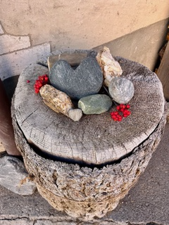

Liebe Leserinnen und Leser,

Schön, dass mein allererster Blog-Artikel den Weg zu Ihnen gefunden hat!

Im Frühling dieses Jahres spürte ich, dass in meinem Leben der Moment für etwas Neues gekommen war. Ich begann, mich intensiv mit Feng Shui zu beschäftigen und trat damit eine Reise in eine für mich völlig neue Welt an. Vieles ist in den letzten Monaten gereift und gewachsen.

Mit Freude darf ich Ihnen heute meine neue Webseite präsentieren. Sie finden dort wertvolle Informationen rund um das Thema Feng Shui und erfahren mehr über mich und meine Arbeit.

Gerne möchte ich Sie in Zukunft mit regelmässigen Blogs an meinen Erfahrungen, Beobachtungen und Inspirationen teilhaben lassen und Ihnen so neue Impulse für Ihr Leben schenken. Wenn Sie sich für meine Beiträge und weitere Neuigkeiten interessieren, freue ich mich sehr, wenn Sie meinen kostenlosen [Newsletter abonnieren](/blog#newsletter).

Ab sofort können Sie mich auch gerne für einen persönlichen [Beratungstermin](/contact) kontaktieren.

Ich wünsche Ihnen einen wundervollen Herbst!

Herzlich,\
**Kati Schepis**

---

Haben Sie dies auch schon so erlebt? Auf einmal war da dieser Moment, wo Ihnen, wie aus dem Nichts, bewusst wurde, dass sich in Ihrem Leben – sei es privat oder beruflich – etwas nicht mehr stimmig anfühlte. Sie spürten, dass die Zeit gekommen war, um neue Wege zu gehen. Dieser «innere Ruf» macht sich oft erst sanft, wie ein Schmetterling, der die Luft durch seine Flügelschläge um sich herum sachte in Vibration versetzt, dann aber immer energischer bemerkbar. Er möchte uns aus unserer Komfortzone und dem Gewohnten herausschubsen und ins Handeln bringen. Aus Bequemlichkeit tendieren wir gerne dazu, solche Rufe erst einmal zu ignorieren, in der Hoffnung, dass sie von selbst wieder verschwinden. Das tun sie aber erfahrungsgemäss nicht, da sie nicht zufällig die Reise aus unserem Unterbewusstsein an die Oberfläche angetreten haben. Ignorieren wir diese innere Stimme, ist das so, wie wenn wir in unserem Schlafzimmer, nach dem Motto «aus den Augen aus dem Sinn», den Schmutz einfach unter das Bett wischen und uns vormachen, für Ordnung gesorgt zu haben. Wenn wir ehrlich zu uns selbst sind, wissen wir aber, dass das nicht der Fall ist. Der Schmutzhaufen unter dem Bett wird grösser und grösser werden und die Luft im Zimmer immer stickiger machen. Ähnlich verhält es sich auch mit unserem Seelenleben: Haben wir einmal erkannt, dass die Zeit da ist, um etwas zu verändern, ist es wichtig, dass wir diesem Impuls Raum geben und uns immer wieder Momente der Ruhe gönnen, um in uns hineinzuhören und herauszufinden, wie und wo es für uns weitergehen könnte. Das Ignorieren von Signalen kann unsere physische und psychische Gesundheit aus dem Gleichgewicht bringen und, schlimmstenfalls, ernsthafte Folgen haben.

## Krankheiten als Botschaften

Bei mir war an einem Donnerstag im März 2026 solch ein Moment gekommen: Nachdem zwei Jahre zuvor bei einer Notfall-Operation eine schwere Form von Endometriose diagnostiziert worden war, hatte an jenem Morgen eine Verlaufskontrolle stattgefunden. Die Frauenärztin hatte erklärt, dass die wiederkehrenden Schmerzen durch die auf dem Ultraschallbild ersichtlichen Verwachsungen beim Darm verursacht würden. Sie hatte mir angeboten, mich jederzeit zu operieren, um diese Verwachsungen wegzuschneiden. Nun stand ich nachdenklich vor dem Spital und überlegte, wie es weitergehen sollte. Mir war klar, dass eine Operation für mich vorerst keine Option war. Ich hatte mich schon länger mit den möglichen Ursachen, insbesondere auch den seelisch-psychischen Gründen, einer Endometriose beschäftigt. Dadurch war mir vieles aus meiner Vergangenheit bewusst geworden, und ich hatte gelernt, Krankheiten als Botschaften zu sehen, die uns auf etwas hinweisen möchten.

An jenem Morgen fiel mir wie Schuppen von den Augen, dass ich mich und meine Vorstellungen von einem glücklichen Leben über eine lange Zeit hinweg vernachlässigt und stattdessen einfach nur funktioniert hatte. Die Scheidung vier Jahre zuvor hatte zur Folge gehabt, dass ich in einem «Nestmodell» lebte, wo ich die Hälfte der Zeit in der angestammten Familienwohnung mit den Kindern und die andere Hälfte der Zeit in einer kleinen Wohnung im Nachbarort verbrachte. Das Hin- und Herpendeln zwischen zwei Wohnsitzen forderte mich kräftemässig und auch emotional. In der Apotheke arbeitete ich in einem Team mit wundervollen Menschen, wo ich mich aufgehoben und verstanden fühlte, aber der Berufsalltag mit vielen, meist oberflächlichen Kundenkontakten, wenig Rückzugsmöglichkeiten und den langen Arbeitstagen brachte mich regelmässig an meine Belastungsgrenze. Ich hatte deshalb mein Pensum reduziert, anstatt, wie es von der Scheidungsanwältin bei den Unterhaltszahlungen eingeplant worden war, aufgestockt.

## Herausfordernde Zeiten für unsere persönliche Entwicklung

Als ich über meine aktuelle Situation sinnierte, wurde mir klar, dass es höchste Zeit war, um meinem Leben einen neuen Impuls zu geben. Die Zeit, um eine neue Aufgabe zu suchen, die mich nährte und wo ich all das, was ich gerne tat und wo ich meine Fähigkeiten hatte, einfliessen lassen konnte. Ich spazierte nach Hause, setzte mich aufs Sofa und begann zu überlegen. Ich liess die letzten fünf Jahre Revue passieren. Jahre, in denen ich viel Schönes, aber auch weniger Schönes erlebt hatte. Jahre, die ihre Spuren hinterlassen, mich gefordert, mich in meiner persönlichen Entwicklung schlussendlich aber ein grosses Stück weitergebracht hatten. Ich hatte gelernt, zu dem, was mir wichtig ist und zu mir selbst zu stehen.

## Unsere Lebensaufgabe: Was macht uns glücklich?

Plötzlich erinnerte ich mich an das kleine Feng-Shui-Buch, das mir vor einigen Monaten beim Stöbern in einem Büchergeschäft in die Hände gefallen war. Die Inneneinrichtung und das Gestalten mit Farben hatte mir schon immer viel Freude bereitet, deshalb standen in meinem Regal zahlreiche Bücher über «Interior Design» und Farbkonzepte. Eine meiner besten Freundinnen, hatte mich immer wieder versucht zu motivieren, beruflich in diese Richtung zu gehen.

Beim Lesen des kleinen Buches hatte ich rasch realisiert, dass es bei Feng Shui um weit mehr ging, als nur darum, Wohnräume hübsch einzurichten: Bei dieser Jahrtausende alten Lehre ging es um das Wissen, wie wir Energien in unserer unmittelbaren Umgebung zu unserem Wohle lenken und nutzen können.

In meiner kleinen Wohnung hatte ich versucht, soweit es mir ohne fundierte Kenntnisse und nur anhand des erworbenen Buches möglich war, die beschriebenen Feng-Shui-Regeln nach und nach umzusetzen. Dies hatte mir sehr viel Freude bereitet. Und auf einmal war er da, dieser Impuls: «Wieso mache ich nicht eine Feng-Shui-Ausbildung?»

Ich setzte mich an den Computer und begann zu recherchieren, wo ich eine solide Ausbildung absolvieren könnte. Der «Zufall» wollte, dass zwei Tage später ein Wochenend-Kurs bei einem zertifizierten Feng-Shui-Institut startete. Der Ausbildner wohnte im Nachbarort und hatte, wie ich, Pharmazie an der ETH in Zürich studiert, den Beruf aber nur kurz ausgeübt, um sich dann über viele Jahre hinweg, auch bei längeren Aufenthalten in Asien, ein immenses Wissen im Bereich Feng Shui und chinesischer Astrologie anzueignen.

Eines ergab das andere, und alles fühlte sich auf einmal ganz leicht und sehr stimmig an. Mittlerweile habe ich die Feng-Shui-Grundausbildung und die Aufbaukurse abgeschlossen und werde voraussichtlich in den nächsten Monaten mein Diplom erwerben. Das Eintauchen in diese neue Welt empfinde ich als eine grosse Bereicherung in meinem Leben. Bei der Analyse meiner eigenen Wohnung war ich beeindruckt von der Klarheit, mit der mein Grundriss meine Lebenssituation widerspiegelte.

<figure class="figure-narrow">

</figure>

## Feng Shui – eine traditionelle Energielehre für mehr Harmonie in der heutigen Zeit

Im Feng Shui wird davon ausgegangen, dass wir uns unsere Wohnumgebung – unbewusst – nach unseren aktuellen Lebensaufgaben aussuchen. Der Grundriss unserer Wohnung, die Lage und die Art, wie wir sie einrichten, sagt viel über uns und über unser Leben aus.

Indem, dass wir die Energien in unserem Umfeld optimal nutzen und Ordnung und Harmonie schaffen, kann uns Feng Shui, nach dem Prinzip «Wie innen so aussen und wie aussen so innen», dabei helfen, unser Leben aufzuräumen, Blockaden zu lösen und in unserer persönlichen Entwicklung weiterzukommen.

Gerade in der aktuellen Zeit, in der viele Menschen sich im «Aussen» nicht mehr aufgehoben fühlen und dieses intuitiv oft als disharmonisch wahrnehmen, ist Feng Shui für mich eine wunderbare Lehre, die uns allen dabei helfen kann, unseren Weg zu gehen, uns dabei immer besser kennenzulernen und unserem Leben wieder neue Perspektiven, Kraft und Positivität zu schenken.

Meine Blog-Artikel schreibe ich ohne die Unterstützung von KI. Es ist mir ein grosses Anliegen, dass wir Menschen uns unserer eigenen Fähigkeiten wieder bewusster werden, diese pflegen und mit Freude einsetzen, damit unsere Welt wieder lebendiger, authentischer und menschlicher wird!

